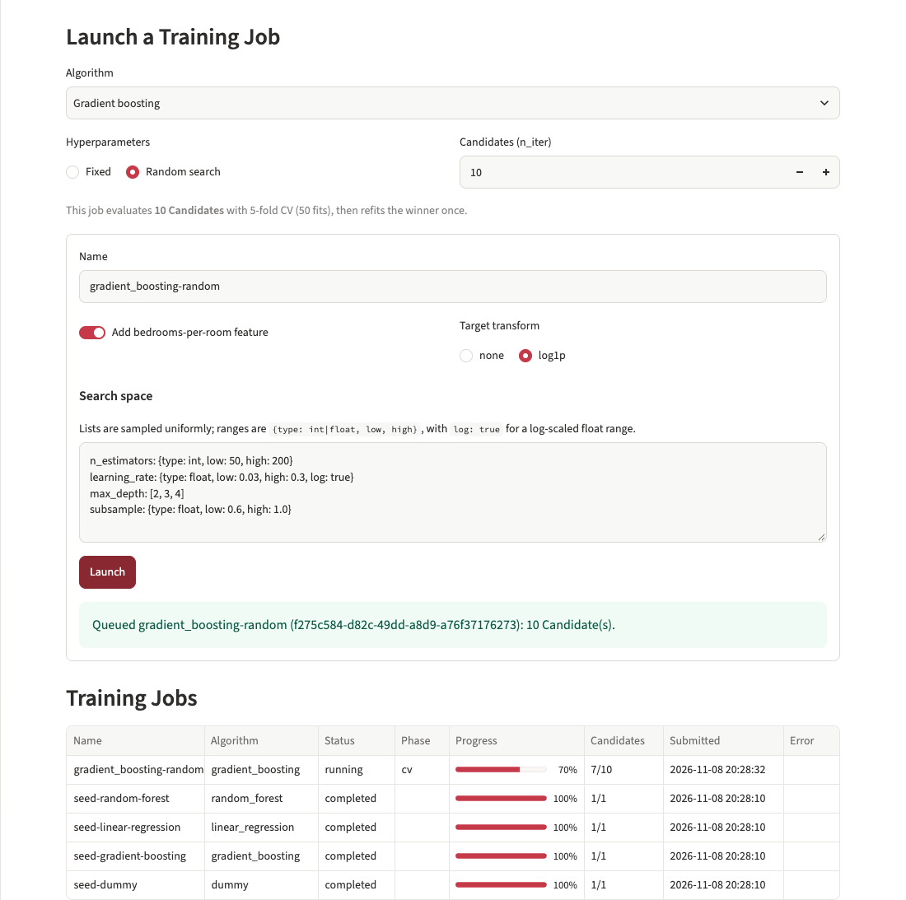
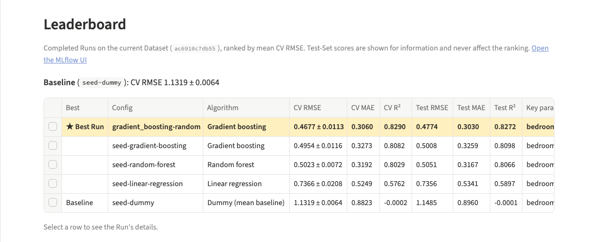
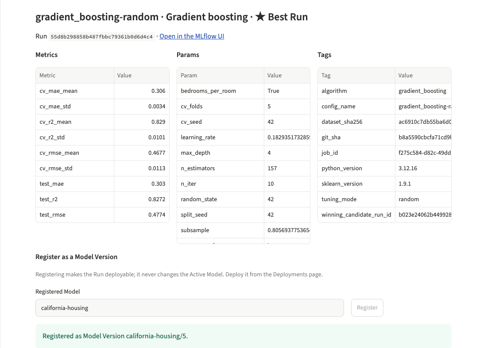
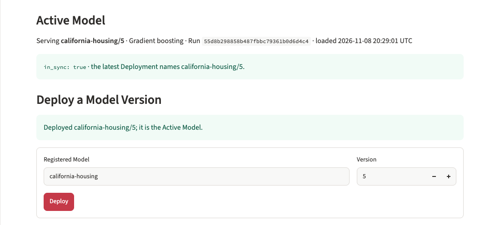
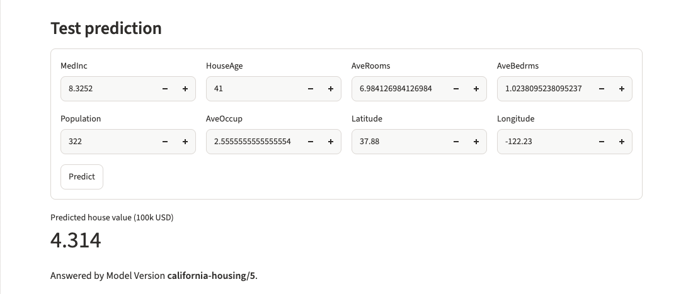
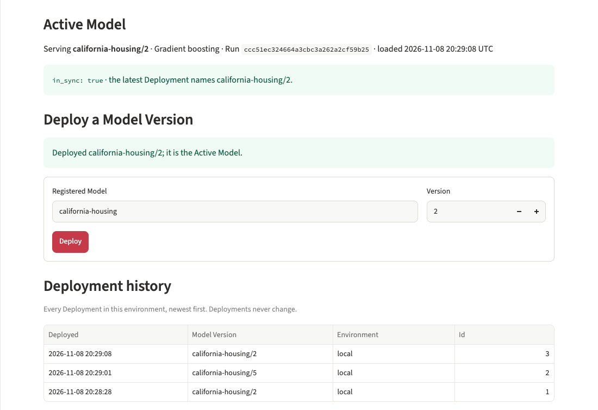

# ADP Experimentation Platform

A local platform where a data scientist trains, tracks and compares regression models on the California Housing Dataset, picks the best one, and chooses which Model Version other teams get predictions from. It replaces an inherited notebook whose results could not be trusted (see [What was wrong with the notebook](#what-was-wrong-with-the-notebook)).

Five services run under Docker Compose: Postgres, an MLflow tracking and registry server, a serving API (FastAPI), a training worker and a Streamlit UI. Capitalised domain terms (Run, Model Version, Deployment, …) are defined in [`GLOSSARY.md`](GLOSSARY.md).

## Quickstart

**Prerequisites:** Docker with Compose v2, and [`uv`](https://docs.astral.sh/uv/) on the host (`make seed` and the CLI run on the host against the stack). The stack uses host ports 5432, 8000, 8501 and 5001.

```sh
make up     # builds the image and starts all five services, waiting until they are healthy
make seed   # REQUIRED ON FIRST SETUP, see below
```

> [!IMPORTANT]
> **Run `make seed` once after the first `make up`.** Without it the system is empty: the Leaderboard has no Runs, the registry has no Model Versions, and `/v1/predict` answers `503` because nothing is deployed. Seed is never run automatically.
>
> `make seed` trains one fixed-hyperparameter Run per algorithm through the same code path the UI uses, registers each Run as a Model Version of `california-housing`, deploys the Best Run through `POST /deploy`, and sends one test prediction. It takes about a minute on a 10-core laptop. Running it again adds Runs and Model Versions; it never resets anything.

Then open:

| What | URL |
| --- | --- |
| Streamlit UI | <http://localhost:8501> |
| Serving API (OpenAPI docs) | <http://localhost:8000/docs> |
| MLflow UI | <http://localhost:5001> |

MLflow is on host port 5001 because macOS's AirPlay Receiver usually holds 5000. Set `MLFLOW_HOST_PORT` to change it.

Other commands: `make train CONFIG=configs/rf-random.yaml` submits an Experiment Config from the CLI and waits for it, `make logs` follows the service logs, `make down` stops the stack (data is kept in Docker volumes), and `make test` and `make lint` run the checks.

## Demo walkthrough

Each step maps to a requirement of the assignment. It assumes `make up && make seed` has run.

The screenshots follow one pass through it on a freshly seeded stack. A gradient boosting random search becomes the new Best Run. It is registered as Model Version 5 and deployed, and then the Active Model is switched back to the seeded Model Version 2.

1. **Launch.** On the **Experiments** page, under *Launch a Training Job*, pick an algorithm (linear regression, random forest, gradient boosting, or dummy, the mean predictor behind the **Baseline**), toggle the bedrooms-per-room feature, choose the target transform, and choose **Fixed** hyperparameters or **Random search**. The caption shows how many Candidates and fits the job will run. Click **Launch** and watch the *Training Jobs* table: status, phase and a progress bar refresh every 2 seconds.
   *Runtime of a default search* (10 Candidates × 5-fold CV, then one refit and the Test Set score), measured end to end on a 10-core laptop: **about 31 s for random forest** and **about 20 s for gradient boosting**. The same searches are in `configs/rf-random.yaml` and `configs/gb-random.yaml` for the CLI.

   

2. **Compare.** When the job finishes, its Run appears on the **Leaderboard**, ranked by mean CV RMSE, with the **Best Run** starred and highlighted and the dummy **Baseline** shown as the bar every model must beat. Test-Set metrics are shown for information only. Select a row to see the Run's metrics, params and tags, or open it in the MLflow UI.

   

3. **Register.** With a Run selected, click **Register** to create a new **Model Version** of `california-housing`. Registering changes nothing that is served. The **Registry** page lists every Model Version with its metrics and Run.

   

4. **Deploy.** On the **Deployments** page, enter the Model Version number and click **Deploy**. The API loads it, checks its signature against the schema and that it returns finite predictions on sample rows, records an append-only **Deployment**, and only then swaps it in as the **Active Model**. A Model Version that fails validation is refused and the Active Model stays as it was.

   

5. **Predict.** Use the *Test prediction* form on the same page, or call the API directly. Every response names the Model Version that produced it:

   ```sh
   curl -s localhost:8000/v1/predict -H 'content-type: application/json' -d '{"rows": [
     {"MedInc": 8.3252, "HouseAge": 41, "AveRooms": 6.984, "AveBedrms": 1.024,
      "Population": 322, "AveOccup": 2.556, "Latitude": 37.88, "Longitude": -122.23}]}'
   # Example answer; the version is whichever Model Version is active, and seed's Best Run may differ:
   # {"model_name":"california-housing","model_version":2,"predictions":[4.21...],"unit":"100k USD"}
   ```

   `/v1/predict` takes 1 to 1,000 rows and rejects missing, extra or non-numeric fields with `422`. `GET /v1/model` shows the loaded Model Version and whether it matches the latest Deployment (`in_sync`).

   

6. **Switch Model Version.** Deploy any other Model Version, newer or older, the same way (or `curl -X POST localhost:8000/deploy -H 'content-type: application/json' -d '{"model_name": "california-housing", "version": 4}'`). The next prediction names the new version, and *Deployment history* shows both Deployments, newest first. Switching back is just another Deployment.

   

`make up && make seed` on a clean clone is the end-to-end smoke check; the UI and `make seed` have no automated tests.

## What was wrong with the notebook

[`model_experiment.ipynb`](model_experiment.ipynb) has nine defects. Each one became a platform rule.

| # | Issue | Evidence in the notebook | Platform rule that prevents it |
| --- | --- | --- | --- |
| 1 | Scaling leaks test data into training | `scaler.fit_transform(df[features])` runs on the whole dataframe before the split | All preprocessing lives inside a scikit-learn `Pipeline`, fitted only on the rows it trains on (each CV fold, then the training portion) |
| 2 | Target overwritten in place | `y_train = np.log1p(y_train)`; re-running the cell applies the log twice, and later cells inherit it | The target transform is an Experiment Config option implemented with `TransformedTargetRegressor`; input data is never mutated |
| 3 | Metrics in log space | MSE and R² computed on `log1p` values | Every metric is computed in original units (MedHouseVal, 100k USD) |
| 4 | Engineered feature carries over between models | The random forest cell adds `X_train["BedroomsPerRoom"]` to the shared `X_train` and `X_test` in place, so every model trained afterwards silently gets the column too, depending on which cells ran | The engineered feature is a pipeline step, toggled per Experiment Config and recorded on the Run |
| 5 | One artifact, always overwritten | Every model is dumped to the same `model.pkl` | Each Run logs its own model; Model Versions are immutable |
| 6 | Results lost | `mse` and `r2` are overwritten by each model; `gb_model` is defined twice | Every Run records its params, metrics, model and metadata in MLflow |
| 7 | Hardcoded local path | `DATA_PATH = "/Users/john/code/regression_experiment/training_data.csv"` | The data path comes from settings (`DATA_PATH`), and every Run records the Dataset's sha256 |
| 8 | Model chosen on the test set | Only a train/test split exists | Candidates and Runs are ranked by 5-fold CV on the training portion; the Test Set is scored once per Run and never used to choose |
| 9 | Untracked serialization | Raw `pickle.dump`, no library versions recorded | Models are logged with MLflow's sklearn flavour, which records the scikit-learn version, and every service runs the same image; only models from our own Runs are loaded, and no pre-trained files are committed |

## Design summary

- **Training.** An **Experiment Config** (YAML, from the UI or the CLI) queues a **Training Job** in Postgres. One worker claims jobs one at a time ([ADR-0003](docs/adr/0003-worker-polls-postgres-jobs-table.md)), evaluates each **Candidate** with 5-fold CV on a fixed 80% training portion, refits the winner, scores it once on the fixed **Test Set**, and records a **Run**, logging each Candidate as an MLflow child run ([ADR-0004](docs/adr/0004-evaluation-protocol-and-persisted-pipeline.md)). The whole pipeline, feature step and target transform included, is persisted as one MLflow model, so serving re-implements nothing.
- **Tracking and registry.** MLflow holds Runs, metrics, models and Model Versions; our Postgres holds only Training Jobs and Deployments ([ADR-0002](docs/adr/0002-mlflow-for-tracking-and-registry.md)).
- **Deploying.** A **Deployment** pins an exact Model Version in an append-only table written only by `POST /deploy`, after the model has loaded and passed validation. MLflow aliases are not used ([ADR-0001](docs/adr/0001-deployments-pin-versions-not-aliases.md)).
- **Serving.** One API process holds the Active Model and swaps it atomically, so a response never mixes Model Versions. Consumer routes are versioned under `/v1`; admin routes (`/deploy`, `/deployments`) sit on a separate router so production can move them behind auth.
- **Why not MLflow's UI and serving.** Open-source MLflow's UI cannot launch a Training Job or deploy a Model Version. Its model server (`mlflow models serve`) serves one model fixed at startup, with no validation gate and no Deployment history. So the Streamlit UI and the serving API do those jobs, and the MLflow UI is linked from each Run for deeper inspection ([ADR-0005](docs/adr/0005-own-ui-and-serving-api-not-mlflow-serving.md)).

Further reading:

- [`GLOSSARY.md`](GLOSSARY.md): the domain vocabulary used in the code, the UI and these docs
- [`docs/adr/`](docs/adr/): the five architecture decision records linked above
- [`docs/architecture-production.md`](docs/architecture-production.md): how this becomes a production system on AWS, with component and rollout diagrams and a mapping from each local piece to its AWS counterpart

## Known limitations

- **The CSV is not a random sample, so there is a geographic shift.** `data/training_data.csv` is the first 16,512 rows of scikit-learn's California Housing dataset in their original order, and the missing rows lean toward Northern California. Our random split and shuffled CV do not simulate that, so scores on the missing rows would likely be worse than our Test Set suggests. [ADR-0004](docs/adr/0004-evaluation-protocol-and-persisted-pipeline.md) has the figures and why we accept it.
- **The target is capped at 5.00001.** 747 rows in the CSV sit at or near the cap (724 at 5.00001, 23 at 5.0), so errors on the most expensive districts are understated. We do not correct for it.
- **The API reconciles only at startup.** It loads the latest Deployment when it starts, and afterwards changes only through its own `/deploy`. A Deployment written any other way, such as a manual database edit, takes effect only after the API restarts. With one API process and `/deploy` as the only writer, this does not happen in the demo.
- **Runs are ranked by mean CV RMSE, never by test RMSE.** The Leaderboard shows Test-Set scores next to each Run, but choosing a Run because its test RMSE is lowest turns the Test Set into a selection set: the chosen score is then optimistically biased, and nothing unseen is left to estimate how the model will do. That is notebook defect 8 again. The Test Set is a final, one-time check of a Run that was already chosen.
- **Only Runs on the current Dataset are compared.** The Leaderboard filters on the Dataset's sha256, so editing the CSV starts a fresh Leaderboard.
- **Input validation checks types, not plausible ranges.** A negative `Population` is accepted and predicted on.

## What was cut for time

The assignment has a 4-hour budget, so these were scoped out up front. Most are covered in the [production architecture](docs/architecture-production.md).

- **Rollback as a feature.** There is no rollback button or event type; switching to an older Model Version is an ordinary Deployment. Rollback with approval belongs to the production control plane.
- **MLflow registry aliases** (see [ADR-0001](docs/adr/0001-deployments-pin-versions-not-aliases.md)).
- **Grid search.** Random search only, 1 to 50 Candidates. A grid can't cover continuous or log-scaled ranges, and its size grows as the product of the list lengths: the default gradient boosting space as a modest grid would be 300 Candidates. With random search, `n_iter` sets the cost directly ([ADR-0004](docs/adr/0004-evaluation-protocol-and-persisted-pipeline.md)).
- **A `/reload` endpoint** and periodic or event-driven reconcile.
- **Deploy guardrails.** No warning when deploying a Model Version that is worse than the Active Model or was trained on a different Dataset.
- **Authentication and authorization** on the UI, the API and the admin routes.
- **Plausible-range input validation and drift detection.**
- **More than one environment.** Every Deployment is in `local`.
- **Concurrent Training Jobs.** One worker runs one job at a time.
- **Automated UI tests**

## Repository layout

```
app/
  ml/         schema, data loading, algorithms, pipeline builder, CV scoring
  jobs/       Experiment Config parsing, submit, the job runner and the worker
  db/         Postgres tables and repositories (Training Jobs, Deployments)
  tracking/   Leaderboard and Best Run, read from MLflow
  registry/   Model Version registration through MLflow
  api/        serving API: model manager, consumer and admin routes, HTTP client
  ui/         Streamlit pages: Experiments, Registry, Deployments
  cli.py      `python -m app.cli submit|seed`
  seed.py     what `make seed` runs
configs/      example Experiment Configs; configs/seed/ holds the seed configs
data/         the Dataset
docs/         ADRs, the production architecture, the assignment and the design notes
tests/        pytest suite, run against a separate `app_test` database
```
