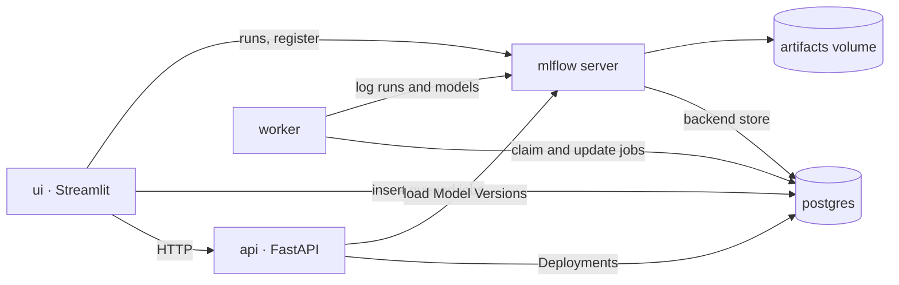

# ML Platform — Refined Implementation Requirements

Nov 8, 2026 · @Enric

Domain terms (Experiment Config, Training Job, Candidate, Run, Best Run, Leaderboard, Registered Model, Model Version, Deployment, Active Model) are defined in [`GLOSSARY.md`](../GLOSSARY.md). Decisions are recorded in [`docs/adr/`](adr/).

## 1. Context and success criteria

We build a local proof of concept, capped at 4 hours, that takes a model from a tracked Training Job to served predictions, and lets the data scientist switch the Active Model at any time. It must run locally with Docker Compose and map onto a production design without rewrites.

**Constraints**

- Hard cap of 4 hours. A well-executed subset beats a rushed full system, so scope was cut up front (section 3) rather than during the build.
- Runs locally via `make up` (Docker Compose), with no cloud dependencies.
- Every local component has a named AWS production counterpart (section 14).

**Done means this demo path works end to end:**

0. First-time setup: `make up`, then `make seed`. The README states that `make seed` is required on a fresh clone. It trains one fixed-hyperparameter Run per algorithm, registers each one, and deploys the Best Run, so the reviewer starts with a populated Leaderboard and an Active Model.
1. Launch a Training Job from the UI, either with fixed hyperparameters or a random search, and watch its progress.
2. Compare completed Runs on the Leaderboard, with the Best Run highlighted.
3. Register a Run as a new Model Version of a Registered Model.
4. Deploy that Model Version from the Deployments page through `POST /deploy`. The API validates it before switching.
5. Send a prediction from the UI test form or `curl` and see which Model Version answered.
6. Switch to a different Model Version by deploying it. The deployment history shows both Deployments.

## 2. Notebook issues and the rule that prevents each

The inherited notebook has nine defects. Each one becomes a platform rule, and the README repeats this table so reviewers can follow the reasoning.

| # | Issue | Evidence in notebook | Platform rule |
| --- | --- | --- | --- |
| 1 | Scaling leaks test data into training | `scaler.fit_transform(df[features])` runs on the full dataframe before the split | All preprocessing lives inside a scikit-learn `Pipeline`, fit only on training folds |
| 2 | Target overwritten in place | `y_train = np.log1p(y_train)`; re-running the cell applies log twice, and later cells inherit it | Target transform is a config option via `TransformedTargetRegressor`; data is never mutated |
| 3 | Metrics in log space | MSE and R² computed on `log1p` values | All metrics are reported in original units (MedHouseVal, $100k) |
| 4 | Engineered feature leaks across models | `X_train["BedroomsPerRoom"] = …` mutates shared state | Engineered features are a pipeline step, toggled per Experiment Config |
| 5 | One artifact, always overwritten | Every model dumps to the same `model.pkl` | Each Run logs its own artifact; Model Versions are immutable |
| 6 | Results lost | `mse` and `r2` overwritten; `gb_model` defined twice | Every Run persists params, metrics, artifact and metadata |
| 7 | Hardcoded local path | `/Users/john/.../training_data.csv` | Data path comes from settings; the Dataset is identified by its sha256 |
| 8 | Model selected on the test set | Only a train/test split exists | Selection uses k-fold CV on the training portion; the Test Set is scored once per completed Run |
| 9 | Untracked serialization | Raw `pickle.dump`, no library versions recorded | MLflow sklearn flavour, scikit-learn version recorded, only artifacts produced by our own Runs are loaded; no pre-trained files are committed |

## 3. Scope

Everything in Must is required for the demo path. Should is built only if time remains. Out of scope items are described in the production doc instead.

| Priority | Items |
| --- | --- |
| Must | CV training with fixed hyperparameters or random search · background worker with progress · MLflow tracking and registry · Best Run highlighted · `/deploy` with validation · reconcile with the DB at API startup · append-only Deployments with a read-only history table · `/v1/predict` (batch), `/v1/model`, `/health` · Streamlit UI · CLI to submit jobs · `make seed` · Docker Compose with Postgres · tests · README · AWS production architecture doc · ADRs |
| Should | `DummyRegressor` baseline in the algorithm list · link from Streamlit to the MLflow UI · CLI `--wait` for ad-hoc submissions (`seed` needs waiting internally regardless) |
| Out of scope | Rollback as a feature (switching to an older Model Version is an ordinary Deployment; rollback belongs to the production control plane) · MLflow aliases (ADR-0001) · grid search · `/reload` endpoint and periodic reconcile · warnings or guardrails when deploying a worse Model Version · authentication · plausible-range input validation · more than one environment · user-extensible algorithm list · dataset versioning beyond a content hash · concurrent Training Jobs · shipping pre-trained model files |

**Accepted risk (reconcile at startup only):** if the latest Deployment row changes without going through `/deploy`, for example after a manual edit or from a second API process, the running API keeps serving its current model until it restarts. With one API process and `/deploy` as the only writer, this does not happen in the demo.

## 4. Architecture

Five containers. Each piece of state has exactly one writer, which makes the production split obvious.



| State | Store | Writer | Readers |
| --- | --- | --- | --- |
| Training Jobs: status, progress, error | Postgres `app.training_jobs` | UI and CLI insert `queued`; worker updates | UI, CLI |
| Runs and Candidates: params, metrics, artifacts | MLflow tracking | Worker | UI Leaderboard, MLflow UI |
| Registered Models and Model Versions | MLflow registry | UI and `seed` (register) | API, UI |
| Deployments: Active Model and history | Postgres `app.deployments` | API only, through `/deploy` | API (startup); UI through `GET /deployments` |

- **One Postgres server, separate databases.** `app` holds our tables behind a SQLAlchemy repository layer. `mlflow` is MLflow's backend store, and MLflow owns that schema and its migrations. `app_test` is created for the test suite. An init script creates all three.
- **No SQLite anywhere.** Tests run against the same Postgres engine as the app, so the job-claim `UPDATE` and the JSON/UUID columns behave the same in both.
- **Volumes:** `pgdata` belongs only to `postgres`, and `mlflowartifacts` only to `mlflow`. The app containers mount no volumes.
- **Artifacts go over HTTP.** The MLflow server proxies artifacts (`--serve-artifacts`), so the worker, UI and API never read artifact paths directly. Moving to S3 later changes one server flag.
- **Service names, not localhost:** clients use `http://api:8000`, `http://mlflow:5000` and `postgres:5432` from settings.

## 5. Data and evaluation protocol

Every Training Job uses the same Dataset, the same Test Set and the same CV folds, so any two Runs on the Leaderboard are directly comparable.

- **Source:** `data/training_data.csv`, committed to the repo. The path comes from settings (`DATA_PATH`).
- **What the file is:** 16,512 rows, no missing values and no duplicates. It is exactly the **first 16,512 rows of scikit-learn's California Housing dataset, in their original order**, not a random sample. The 4,128 rows that are missing are the dataset's tail, and they skew toward Northern California: mean latitude 37.1 against 35.3, latitude range 34.1–42.0, mean MedHouseVal 2.26 against 2.02. If reviewers score on those rows, they will see a geographic shift that our random split and shuffled CV do not simulate.
- **Decision:** we treat the CSV as all the data we have, and keep a random split with shuffled k-fold CV. The README describes the shift as a known limitation. The production doc lists geographic drift as a monitoring signal. We do not build spatial CV (ADR-0004).
- **Schema in one module** (`app/ml/schema.py`): the 8 float features `MedInc`, `HouseAge`, `AveRooms`, `AveBedrms`, `Population`, `AveOccup`, `Latitude`, `Longitude`, and the target `MedHouseVal` in units of $100k. Training, the API request model and the UI form all import it. The loader checks columns and dtypes and fails fast.
- **Dataset identity:** the sha256 of the CSV, logged on every Run as `dataset_sha256`. The Leaderboard only compares Runs that have the current hash.
- **Split:** 80/20 train/test with `random_state=42`, fixed in settings rather than in each Experiment Config. The Test Set is 3,303 rows. It is logged as `split_seed` and `test_size` and is never used for selection.
- **Selection:** `KFold(n_splits=5, shuffle=True, random_state=42)` on the training portion. Every Candidate in every Training Job sees the same folds.
- **Metrics, all in original units:** RMSE (primary), MAE and R². CV metrics are logged as mean and std across folds. Test metrics are logged once, after refitting the winning Candidate on the full training portion.
- **Best Run:** the completed Run with the lowest mean CV RMSE on the current dataset hash. Test RMSE is shown on the Leaderboard next to it but is never used to rank. The README states this rule explicitly: choosing a Run by its test RMSE reintroduces notebook issue 8.

**Known data property:** the target is capped at 5.00001; 747 rows in the CSV sit at or near the cap (724 at 5.00001, 23 at 5.0), so errors on expensive districts are understated. The README lists this as a limitation, and we do not correct for it.

## 6. Experiment Config and training flow

An Experiment Config is validated input. A fixed-hyperparameter job is treated as a search with exactly one Candidate, so both modes share one code path.

**Config** (Pydantic `ExperimentConfig`; the UI builds it, the CLI loads it from YAML):

```yaml
name: gb-log-target
algorithm: gradient_boosting      # linear_regression | random_forest | gradient_boosting | dummy
features:
  bedrooms_per_room: true
target_transform: log1p           # none | log1p
tuning:
  mode: random                    # fixed | random
  n_iter: 10                      # random only, 1..50
  params:
    n_estimators: {type: int, low: 50, high: 200}
    learning_rate: {type: float, low: 0.01, high: 0.3, log: true}
    max_depth: [2, 3, 4, 5]
random_state: 42
```

- **Parameter values by mode:** `fixed` takes single values. `random` takes lists, which are sampled uniformly, or ranges `{type, low, high, log}`, which map to scipy `randint`, `uniform` or `loguniform`.
- **Algorithms are a fixed list** in `app/ml/algorithms.py`. Each has default fixed values and a default search space, and both prefill the UI. `dummy` takes no parameters and only runs in `fixed` mode.
- **Defaults are capped for runtime:** default `n_iter=10`, random forest `max_depth` ≤ 20 and `n_estimators` ≤ 200, and `cross_validate(n_jobs=-1)`. A default random search should finish in about 30–60 seconds on a laptop, and the README states the expected runtime. The data scientist can raise any of these in the form.
- **Validation at submit time:** unknown parameter names are rejected (checked against the estimator's `get_params()`), `n_iter` must be between 1 and 50, and the Candidate count is shown before launch.
- **Pipeline per Run:** optional `BedroomsPerRoom` step (a transformer that appends the ratio, with safe division) → `StandardScaler` for linear regression only → estimator. With `target_transform: log1p`, the whole pipeline is wrapped in `TransformedTargetRegressor(func=np.log1p, inverse_func=np.expm1)`, so predictions and metrics come out in original units.
- **Parameter names stay simple:** configs use estimator-level names, and the code adds the pipeline prefixes.

**Training Job flow in the worker:**

1. Load the CSV, compute its hash and apply the fixed split.
2. Enumerate Candidates with `ParameterSampler(n_iter, random_state)`. `fixed` mode gives one Candidate.
3. Open an MLflow parent run (the Run) in the single MLflow Experiment `california-housing`. Tag it with `job_id`, `config_name`, algorithm and mode. Log the config YAML, dataset hash, split settings, git SHA, and the Python and scikit-learn versions.
4. For each Candidate, run `cross_validate` on the fixed folds (RMSE, MAE, R²), log it as an MLflow child run with its params and CV metrics, then update the job's progress.
5. Choose the Candidate with the lowest mean CV RMSE and log its params and CV mean and std on the Run.
6. Refit it on the full training portion, score it once on the Test Set, and log the test metrics.
7. Log the fitted pipeline with `mlflow.sklearn.log_model`, with a signature built from the schema and an input example of 5 rows.
8. Mark the job `completed` with its `mlflow_run_id`. Any exception marks the job `failed` with the error text, and the Run `FAILED`.

**One MLflow Experiment for everything.** All Runs from all Training Jobs and algorithms land in `california-housing`, so the Leaderboard and the MLflow UI compare them in one table. The config name is a run tag, not a separate MLflow Experiment. The Leaderboard ranks Runs only. Candidates (child runs) stay visible in the MLflow UI.

## 7. Training Jobs and worker

Training Jobs are rows in `training_jobs`. One worker process runs them one at a time and writes progress after every Candidate.

| Column | Type | Notes |
| --- | --- | --- |
| `id` | UUID | Primary key |
| `name` | text | From the config |
| `config` | JSONB | Validated `ExperimentConfig` |
| `status` | enum | `queued`, `running`, `completed`, `failed` |
| `phase` | text, nullable | `cv`, `refit`, `logging` |
| `progress_done`, `progress_total` | int | Candidates finished and total |
| `mlflow_run_id` | text, nullable | Set when the Run opens |
| `error` | text, nullable | Exception message on failure |
| `created_at`, `started_at`, `finished_at` | timestamptz |  |

**Submitting:** the UI and the CLI (`uv run python -m app.cli submit configs/gb.yaml`, wrapped as `make train CONFIG=…`) both call one `jobs.submit(config)` service, which validates the config and inserts a `queued` row.

**Worker loop:**

- Every 2 seconds (`WORKER_POLL_SECONDS`), pick the oldest `queued` job and claim it with `UPDATE … SET status='running' WHERE id=:id AND status='queued'`. Run it only if exactly one row changed.
- On startup, mark any `running` rows as `failed` with the error `worker restarted`. With a single worker, any such row is orphaned.
- The work itself is one function, `run_job(job_id)`, which tests call directly without the polling loop.

**Progress in the UI:** while any job is `queued` or `running`, the jobs table refreshes every 2 seconds and shows a progress bar (`progress_done / progress_total`) and the current phase.

## 8. Registry and Best Run

MLflow's registry holds Registered Models and their auto-incremented Model Versions. Our code adds only the Leaderboard and the rule that defines the Best Run.

- **Registering and deploying are separate actions.** Registering makes a Run available for deployment as a new Model Version, and never changes what is served. Deploying is a later, explicit action on the Deployments page (section 9).
- **Register:** from a completed Run on the Leaderboard, the user picks a Registered Model name (default `california-housing`, free text allowed). Registering goes through the registry client, which registers the Run's logged model (`models:/<model_id>`; MLflow 3 no longer stores it under `runs:/<run_id>/model`), and MLflow assigns the next version.
- **Version tags:** `job_id`, `algorithm`, `cv_rmse_mean`, `cv_rmse_std`, `test_rmse` and `dataset_sha256`, so the Registry page needs no extra lookups.
- **One Model Version per Run and name:** the Register button is disabled for a Run that is already registered under that name.
- **No aliases.** MLflow aliases are deliberately not used. The Active Model is defined only by Deployments (ADR-0001).
- **Best Run:** the Leaderboard highlights it. The Registry page puts a "best" badge on any Model Version created from it.
- **Noise is visible:** the Leaderboard shows CV RMSE as mean ± std, plus the `dummy` baseline's RMSE when one exists, so a narrow win can be judged by eye. There is no automatic significance test.

## 9. Deployments and switching models

A Deployment is an append-only row naming an exact `(model_name, version)`. The latest row for an environment is the Active Model. Only the API writes Deployments, and only after it has validated the model (ADR-0001).

| Column | Type | Notes |
| --- | --- | --- |
| `id` | bigint identity | Ordering key; the highest id per environment is active |
| `environment` | text | Always `local` for now |
| `model_name`, `model_version` | text, int | Exact version, never an alias |
| `created_at` | timestamptz |  |

Rows are never updated or deleted. The UI shows them in a read-only history table, newest first.

**`POST /deploy {model_name, version}`:**

1. If the requested Model Version is already loaded, return 200 and write nothing.
2. Load `models:/{model_name}/{version}` from MLflow into a local variable.
3. Validate it: the signature's input columns equal the schema's 8 features, and a prediction on the schema's bundled sample rows returns finite values of shape `(n,)`.
4. On failure, return 422 with the reason. Nothing is written and the current model keeps serving.
5. On success, insert the Deployment in a transaction.
6. Swap the in-memory model under a lock and return the new model info.

If the insert fails, return 500 and do not swap. If the process dies between steps 5 and 6, startup loads the already validated model.

**Switching to an older Model Version** is an ordinary Deployment of that version. There is no rollback button or rollback event type. Rollback with approval belongs to the production control plane.

**Startup reconcile:** read the latest Deployment, then run steps 2, 3 and 6 without inserting anything. If there is no Deployment, or loading or validation fails, the API starts without a model: `/v1/predict` returns 503, `/health` reports `degraded`, and `/v1/model` shows `in_sync: false`.

The API runs as a single uvicorn worker, and the lock serializes concurrent deploys within it.

## 10. Serving API and ModelManager

Consumer routes are versioned under `/v1`, so the request contract can evolve independently of Model Versions. Admin routes are unversioned and live in a separate router.

| Method | Path | Used by | Request | Response |
| --- | --- | --- | --- | --- |
| GET | `/health` | Ops | – | `status` (`ok` or `degraded`), `model_loaded` |
| GET | `/v1/model` | Consumers, UI | – | Loaded model (name, version, run id, algorithm, loaded at), desired Model Version from the DB, `in_sync` |
| POST | `/v1/predict` | Consumers, UI test form | `{"rows": [ {8 named floats}, … ]}`, 1 to 1,000 rows | `predictions` (list, same order), `unit: "100k USD"`, `model_name`, `model_version` |
| POST | `/deploy` | UI (admin), `seed` | `model_name`, `version` | New model info; 422 or 500 on failure |
| GET | `/deployments` | UI (admin) | `limit` | Deployments, newest first |

- **Request model** is built from the schema module: each row requires all 8 fields as floats, with `extra="forbid"`. Types only; range checks are left to the production doc. Bad input, an empty `rows` list or more than 1,000 rows gets FastAPI's standard 422.
- **Predict** builds a DataFrame in schema column order and calls the pipeline once for the whole batch. It reads the current model reference once per request, so a swap in the middle of a request is safe, and every prediction in one response comes from the same Model Version.
- **Admin endpoints** live in a separate router tagged `admin`, so production can put them behind auth or an internal network without touching consumer routes.
- **`ModelManager`** exposes `current()`, `load_and_validate(ref)`, `swap(loaded)`, `reconcile()`, `deploy(ref)`, `status()` and `history(limit)`. A `LoadedModel` dataclass holds the pipeline, name, version, run id, algorithm and `loaded_at`.
- **`DeploymentRepository`** exposes `latest(env)`, `append(env, model_version_ref)` and `history(env, limit)`.
- **`RegistryClient`** wraps MLflow (`load_model(ref)`, `get_version_metadata(ref)`), so tests use a fake and the registry backend can change without touching the API.
- **Logging:** one structured stdout line per request, with the Model Version, row count and latency.

## 11. Streamlit UI

Three pages cover the whole workflow. The UI holds no training code and no SQL, only calls to services and HTTP clients.

| Page | What the data scientist does | Talks to |
| --- | --- | --- |
| Experiments | Fill in the Experiment Config form: algorithm, feature toggle, target transform, fixed or random, `n_iter`, prefilled params, and the Candidate count shown before launch · watch the jobs table with progress bars · browse the Leaderboard: CV RMSE mean ± std, test RMSE, MAE, R², algorithm, config name, key params, Best Run highlighted · open a Run's details · register a Run · open the Run in the MLflow UI | Jobs service (Postgres), MLflow client |
| Registry | Browse Registered Models and their Model Versions with tags and the "best" badge (read-only) | MLflow client |
| Deployments | See the Active Model and `in_sync` · deploy a chosen name and version · read the Deployment history table · send a test prediction from a form prefilled with a sample row and see which Model Version answered | API only |

Form polish is out of scope. Errors from the API (422, 503) are shown as-is with their reason.

## 12. Repo structure, tooling and Docker Compose

One Python package and one image run the four app services. Packages are split by responsibility, so the UI, worker and API import the same schema and services.

```text
adp-experimentation-platform/
├── app/
│   ├── settings.py             # pydantic-settings: URLs, DB URLs, seeds, limits
│   ├── ml/
│   │   ├── schema.py           # features, target, units, sample rows
│   │   ├── data.py             # load, hash, split, folds
│   │   ├── algorithms.py       # fixed list, defaults, capped search spaces
│   │   ├── pipeline.py         # build_pipeline(config)
│   │   └── training.py         # candidates, CV, refit, test scoring
│   ├── jobs/
│   │   ├── config.py           # ExperimentConfig
│   │   ├── service.py          # submit, list, get, wait
│   │   ├── runner.py           # run_job(job_id): training + MLflow logging
│   │   └── worker.py           # polling loop, orphan recovery
│   ├── db/
│   │   ├── tables.py           # SQLAlchemy models
│   │   ├── session.py          # engine, create_all
│   │   └── repositories.py     # JobRepository, DeploymentRepository
│   ├── registry/client.py      # RegistryClient (MLflow wrapper)
│   ├── api/
│   │   ├── main.py             # app factory, startup reconcile
│   │   ├── routes_public.py    # /health /v1/model /v1/predict
│   │   ├── routes_admin.py     # /deploy /deployments
│   │   └── model_manager.py
│   ├── ui/
│   │   ├── app.py
│   │   └── pages/              # experiments.py registry.py deployments.py
│   └── cli.py                  # submit, seed
├── configs/
│   ├── *.yaml                  # example Experiment Configs
│   └── seed/*.yaml             # one fixed-hyperparameter config per algorithm
├── data/training_data.csv
├── docker/postgres-init.sql    # creates app, mlflow, app_test databases
├── docs/
│   ├── architecture-production.md
│   └── adr/                    # 0001-… (see section 14)
├── tests/
├── GLOSSARY.md
├── Dockerfile
├── docker-compose.yml
├── Makefile
├── pyproject.toml, uv.lock
└── README.md
```

**Tooling:** Python 3.12, `uv` with a committed `uv.lock`, `ruff` for lint and format, and `pytest`. Tables are created with `create_all` at startup, and Alembic migrations are named in the production doc. One image for all app services guarantees that the worker and the API run the same scikit-learn version, which serialized pipelines depend on.

**Makefile targets:** `install`, `lint`, `format`, `test` (starts the Compose `postgres` service first), `up`, `down`, `logs`, `train CONFIG=…`, and `seed`.

**`make seed`** requires the stack to be running and must be run once on a fresh clone. The README says this in its quickstart. It submits every `configs/seed/*.yaml` through `jobs.submit`, waits for the jobs to finish, registers each Run under `california-housing`, and deploys the Best Run through `POST /deploy`. Everything goes through the real code path, and no pre-trained files are committed. Running it again adds new Runs and Model Versions; it does not reset anything.

| Service | Command | Port | Volumes |
| --- | --- | --- | --- |
| `postgres` | `postgres:16` with the init script | 5432 | `pgdata` |
| `mlflow` | `mlflow server` with the Postgres backend store, `--artifacts-destination`, `--serve-artifacts` | 5000 (host 5001: macOS AirPlay holds 5000) | `mlflowartifacts` |
| `api` | `uvicorn app.api.main:app --workers 1` | 8000 | – |
| `worker` | `python -m app.jobs.worker` | – | – |
| `ui` | `streamlit run app/ui/app.py` | 8501 | – |

`mlflow` waits for a healthy `postgres`. `api`, `worker` and `ui` wait for healthy `postgres` and `mlflow`. Settings come from env vars: `MLFLOW_TRACKING_URI=http://mlflow:5000`, `API_URL=http://api:8000`, `APP_DB_URL=postgresql+psycopg://…@postgres:5432/app`. The training CSV is copied into the image.

## 13. Tests

Tests target the agreed risks: leakage, unsafe model switching, the API contract and persistence. `make test` runs them in seconds on a small sample of the CSV, against the `app_test` database (recreated per session), with a fake `RegistryClient`. The ML tests need no database.

| Area | Test | What it proves |
| --- | --- | --- |
| Pipeline | After fitting on a subset, the scaler's `mean_` equals that subset's mean, not the full data's | Preprocessing is fit only on training data |
| Pipeline | With `log1p`, predictions and metrics are on the original target scale | Notebook bug 3 cannot recur |
| Pipeline | `BedroomsPerRoom` with zero rooms yields finite values | The engineered feature is safe at inference |
| Config | Unknown param rejected; `n_iter` outside 1..50 rejected; `fixed` gives 1 Candidate; random gives `n_iter` | Bad jobs fail at submit, not in the worker |
| Jobs (Postgres) | A second claim of the same job changes 0 rows; startup marks orphaned `running` jobs `failed`; an exception in `run_job` records `failed` with the error | The worker state machine is sound |
| Jobs (integration) | `run_job` on the sample with MLflow in a temp dir produces a Run, child runs and a logged model | The training path works end to end |
| ModelManager | A model that fails validation leaves the current model in place; a signature mismatch is rejected | Safe switching |
| `/deploy` | Failure writes no Deployment; success writes one and `/v1/model` reports the new version; redeploying the loaded version writes nothing | DB and memory stay consistent |
| Startup | With a Deployment in the DB, startup loads that Model Version; with none, `/health` is `degraded` | Reconcile works |
| `/v1/predict` | A missing, extra or wrongly typed field returns 422; empty or over-limit `rows` returns 422; no model returns 503; a batch returns one prediction per row with the Model Version | Consumer contract |
| Repository (Postgres) | `latest` returns the highest id per environment; `history` is newest first | The Active Model pointer is correct |

## 14. Deliverables

The private repo contains the code, a README, an AWS production architecture doc with Mermaid diagrams, ADRs and the glossary.

**README.md:**
- a quickstart: `make up`, then **`make seed` (required on first setup)**, then the three URLs
- the demo walkthrough from section 1, with the expected runtime of a default search
- the notebook issues table from section 2
- a design summary
- known limitations: the geographic shift between the CSV and the missing rows, the capped target, startup-only reconcile, and the rule that Runs are ranked by CV, not test RMSE
- what was cut for time

**docs/architecture-production.md:** a Mermaid component diagram, a Mermaid sequence diagram of a production rollout (including rollback through the control plane), and this mapping from each local piece to its AWS counterpart:

| Concern | Local proof of concept | Production (AWS) |
| --- | --- | --- |
| App metadata | Postgres container + `create_all` | Amazon RDS for PostgreSQL (Multi-AZ) + Alembic migrations |
| Tracking and registry | MLflow server on Postgres | Amazon SageMaker managed MLflow, or self-hosted MLflow on ECS backed by RDS |
| Artifacts | Volume behind MLflow's artifact proxy | S3 with versioning and KMS encryption, sha256 checked at load |
| Training | One worker polling `training_jobs` | SQS-queued jobs run as SageMaker Training Jobs or EKS Jobs, with resource limits and autoscaling |
| Serving | One uvicorn process; reconcile at startup | N replicas on EKS or ECS behind an ALB, each reconciling when the control plane calls an internal reconcile endpoint, plus a periodic check; rolling or canary rollout |
| Deploy control | `/deploy` on the serving API | A separate control-plane service with IAM-based authorization, approval, audit, and rollback |
| Auth | None | IAM Identity Center SSO for the UI; API Gateway with API keys or Cognito OAuth for consumers; admin routes internal only |
| Input validation | Types only | Plausible ranges and schema drift checks |
| Observability | Stdout logs | CloudWatch structured logs and metrics (latency, errors, prediction distribution), OpenTelemetry/X-Ray tracing, prediction logs to S3 for drift analysis, including geographic drift |
| Environments | `local` only | Separate AWS accounts for dev, staging and prod with promotion gates |
| CI/CD | `make lint test` by hand | GitHub Actions on every PR, images pushed to ECR, automated gate: the candidate must beat the Active Model's CV RMSE |
| Data | CSV in repo, sha256 | Versioned datasets in S3 with validation |

One closing line notes the equivalents on other clouds (for example GCP Cloud SQL, GCS, Vertex AI, GKE). Only the service names change, not the design.

**docs/adr/:** short records in the repo's ADR format, written when the decision lands in code:

1. `0001` Deployments pin exact Model Versions; MLflow aliases are not used. Covers validating before committing, the API as the only writer, startup reconcile, and no rollback feature. *(Written.)*
2. `0002` MLflow for tracking and registry instead of custom tables.
3. `0003` A worker polling a Postgres jobs table instead of a message broker.
4. `0004` Evaluation protocol and persisted pipeline: fixed Test Set, shuffled k-fold CV for selection, the Test Set scored once per Run, the known geographic shift, and the full pipeline (feature steps and target transform) persisted against one shared schema.

## 15. Time plan (4 hours)

The plan is tight, so each slot has a concrete exit check and the documentation slot is protected at 55 minutes.

| Slot | Min | Work | Exit check |
| --- | --- | --- | --- |
| 0:00–0:20 | 20 | uv project, settings, schema, Makefile, Dockerfile stub, Compose `postgres` with init script | `make test` runs against `app_test` |
| 0:20–1:00 | 40 | `ml/`: data, algorithms, pipeline, CV and random search; pipeline and config tests | A random search on the sample returns the best Candidate |
| 1:00–1:35 | 35 | `db/` and `jobs/`: tables, repositories, submit, `run_job` with MLflow logging, worker, CLI | `make train` produces a Run with a logged model |
| 1:35–2:10 | 35 | API: `RegistryClient`, `ModelManager`, endpoints, deploy and startup reconcile, API tests | `curl` deploy, then a batch predict, works |
| 2:10–2:45 | 35 | Streamlit: three pages | The demo path works in the browser |
| 2:45–3:05 | 20 | Compose: all five services, healthchecks, `seed` and its configs | `make up && make seed` works from a clean clone |
| 3:05–4:00 | 55 | README, AWS production doc, remaining ADRs | Docs committed |

- **Write ADRs as you go,** about 5 minutes each, when the decision lands in code.
- **Cut order if a slot overruns by more than 10 minutes:** MLflow UI link → `dummy` baseline → CLI `--wait` → Run detail view → Registry page (fold the "best" badge into the Deployments version picker). `seed` is Must and is not cut. The docs slot never drops below 45 minutes.

## 16. Assumptions and items to verify

The defaults below were not explicitly decided. Change any of them before implementation starts.

**Assumed defaults**

- 5 CV folds, 80/20 split, seed 42 everywhere.
- Single MLflow Experiment `california-housing`; default Registered Model name `california-housing`, free text allowed.
- Random search: default `n_iter` = 10, allowed range 1..50.
- `/v1/predict` accepts 1 to 1,000 rows per request.
- `dummy` baseline is in the algorithm list (Should); if built, it is also a seed config.
- A Run can be registered once per Registered Model name.
- One Training Job runs at a time.
- Python 3.12, Postgres 16.

**Verified**

- [x] `training_data.csv` has the 8 features plus `MedHouseVal`, 16,512 rows, no NaNs or duplicates, and equals the first 16,512 rows of scikit-learn's dataset in original order (section 5).
- [x] Target cap is 5.00001, with 747 rows in the CSV at or near the cap (724 at 5.00001, 23 at 5.0).

**Verify during implementation**

- [ ] Pinned MLflow version: argument names of `mlflow.sklearn.log_model` (MLflow 3 changed some), the model URI returned for registration, `--serve-artifacts` behaviour, and the Postgres backend driver (`psycopg2` in the MLflow image).
- [ ] The pinned Streamlit version supports periodic refresh of a page fragment for the jobs table.
- [ ] A default random search finishes in about 30–60 seconds and the random forest artifact size is acceptable with the capped defaults.
- [ ] `make seed` finishes in under a minute from a clean `make up`.
