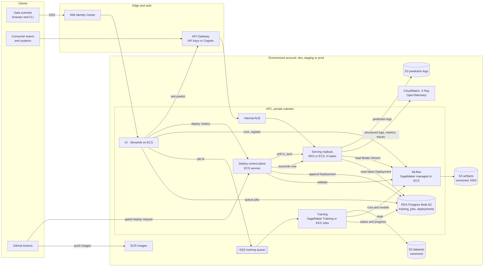
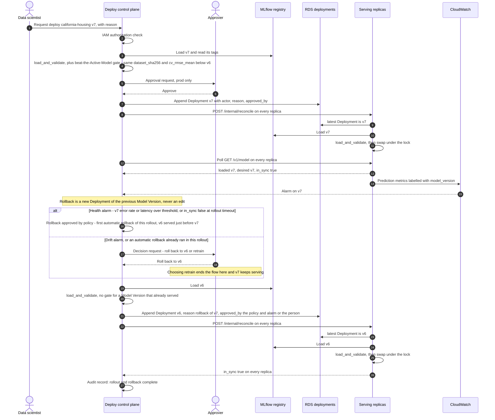

# Production architecture on AWS

This document describes how the proof of concept becomes a production system on AWS without major rewrites. The core design stays the same in production:

- **Each piece of state has one writer.** Training Jobs belong to the queue and the job record, Runs and Model Versions belong to MLflow, and Deployments belong to the deploy control plane.
- **Deployments pin exact Model Versions** (ADR-0001). A Deployment is an append-only row naming `(model_name, model_version)`. MLflow aliases are never used to decide what is served.
- **Serving replicas only reconcile.** A replica loads and validates the Model Version that the latest Deployment names, and it never writes a Deployment. In the proof of concept the single API process is also the writer, through `/deploy`. In production that route moves to a separate control plane.

Vocabulary follows [GLOSSARY.md](../GLOSSARY.md).

## What changes and what stays

| Built in the proof of concept | Production |
| --- | --- |
| `ModelManager.load_and_validate` (signature equals the schema's 8 features, finite predictions of shape `(n,)` on the sample rows) | Unchanged. Replicas run it on every reconcile. The control plane runs the same check before it writes a Deployment. |
| `ModelManager.reconcile`, at startup only | Unchanged code, called on three triggers: startup, a reconcile call from the control plane after it writes a Deployment, and a periodic check. A failed reconcile keeps the loaded Model Version and reports `in_sync: false`. |
| `ModelManager.deploy` and `POST /deploy` | Moved to the control plane, with authorization, approval and audit. Replicas no longer mount the admin router. |
| `DeploymentRepository` (`latest`, `append`, `history`) and the `deployments` table | Same table and same append-only rule, in RDS. The control plane is the only role with `INSERT`. Replicas get a read-only role. Production adds `actor`, `reason` and `approved_by` columns through a migration. |
| `ApiClient` (`app/api/client.py`), used by the UI and `seed` | Split in two: admin calls (`deploy`, `deployments`) go to the control plane, consumer calls (`model_status`, `predict`) go to the serving API through API Gateway. |
| `RegistryClient` protocol, `MlflowRegistryClient` | Unchanged. The tracking URI points at SageMaker managed MLflow, or at MLflow on ECS. |
| `jobs.service.submit` and the `training_jobs` row as the status record | Unchanged for callers. `submit` also sends the job id to SQS. The table stays the status record that the UI and CLI read (ADR-0003). |
| `jobs.runner` evaluation protocol (ADR-0004) | Unchanged. It runs inside a SageMaker Training Job or an EKS Job instead of the polling worker. |
| Consumer contract: `GET /health`, `GET /v1/model`, `POST /v1/predict` | Unchanged, now served through API Gateway. Every prediction response still names the Model Version that produced it. |

## Component diagram

Training runs as a managed job, separate from serving. The control plane is the only component that writes a Deployment. Replicas read the `deployments` table and MLflow and never write to them. The UI keeps its proof-of-concept split. It reads and registers through MLflow and queues jobs in the database. It sends deploy and history calls to the control plane, which replaces the admin routes the UI calls today, and its test prediction form calls the consumer API like any other consumer.

## Production rollout and rollback

The rollout below deploys `california-housing` version 7 over version 6, sees it misbehave, and rolls back. Rollback is not a new mechanism. It is another Deployment, of version 6, written by the control plane. This keeps ADR-0001's rule that Deployments are never changed or removed. Version 7 still appears in the history, followed by the Deployment that replaced it.

Which alarms roll back without a person:

- **Health alarms roll back automatically.** An alarm on error rate or latency for the new Model Version, or replicas still at `in_sync: false` when the rollout times out, points at the new Model Version, and the previous one already served in this environment. Rolling back is the fix, and waiting for an approver only prolongs bad responses. The rollback is an ordinary Deployment, so it is audited like any other. `approved_by` records the policy and the alarm instead of a person.
- **Drift alarms go to a person.** Drift in the incoming features or predictions usually comes from the data, not the new Model Version. The geographic shift in ADR-0004 would hurt the previous Model Version just as much. The control plane opens a request, and a person decides whether to retrain or roll back.
- **One automatic rollback per rollout.** The control plane rolls back automatically only once per rollout, and only to the Model Version that served immediately before. If that version also alarms, a person takes over, so two bad versions cannot keep replacing each other.

How this behaves on failure:

- **Validation fails in the control plane:** nothing is written and the Active Model keeps serving, the same as `/deploy` returning 422 today.
- **A replica cannot load or validate the new version:** that replica keeps serving its loaded Model Version and reports `in_sync: false` on `/v1/model`. The control plane does not report the rollout complete, and it alarms after a timeout. Because the Deployment is already recorded, the remedy is another Deployment, usually of the previous Model Version.
- **A replica misses the reconcile call:** every 60 seconds each replica compares its loaded Model Version with the latest Deployment (the `status()` behind `/v1/model`) and calls `reconcile()` when they differ, so a failed, missed or repeated call only delays convergence. Startup still reconciles before the replica passes its readiness check.
- **Mixed versions during a rollout:** each request reads the model reference once, so a response never mixes versions, and every response names its version. For a gradual rollout, the control plane can deploy to a canary target group first. The design keeps Deployments per environment, so a canary is a short-lived environment such as `prod-canary` with its own Deployment rows, not a second pointer.

## Mapping from the proof of concept to AWS

Every component of the proof of concept has a named counterpart.

| Concern | Local proof of concept | Production (AWS) |
| --- | --- | --- |
| App metadata | `postgres` container on the `pgdata` volume, databases created by `docker/postgres-init.sql`, tables created with `create_all` | Amazon RDS for PostgreSQL, Multi-AZ, with automated backups in place of the volume. The `app` and `mlflow` databases are created by infrastructure code (Terraform or CDK), and Alembic migrations run as a deploy step. Separate DB roles: control plane writes Deployments, replicas read only. |
| Tracking and registry | `mlflow` server container on the `mlflow` database | Amazon SageMaker managed MLflow, or MLflow on ECS backed by RDS. Each environment account has its own MLflow, holding the one `california-housing` Experiment (ADR-0002). |
| Artifacts | `mlflowartifacts` volume behind MLflow's artifact proxy (`--serve-artifacts`) | S3 with versioning and KMS encryption, and the artifact's sha256 checked at load. On MLflow on ECS this is one server flag, `--artifacts-destination=s3://…` (ADR-0002). SageMaker managed MLflow stores artifacts in an S3 bucket you configure. |
| Training | One `worker` polling `training_jobs` (ADR-0003) | SQS plus SageMaker Training Jobs or EKS Jobs, with resource limits, autoscaling and concurrent jobs. A dead-letter queue and a job timeout replace the restart-time orphan sweep. |
| Serving | One uvicorn process (`api`), reconcile at startup only | EKS or ECS replicas behind an ALB. Each replica reconciles when the control plane calls `POST /internal/reconcile` after writing a Deployment, plus a periodic check, plus at startup. The control plane finds replicas the same way it polls them for `in_sync`, through ECS service discovery or a headless Kubernetes Service. `/internal/reconcile` takes no input and only makes the replica re-read the latest Deployment, so it cannot change what is served. It listens on a separate internal port that only the control plane's security group can reach, and it is not routed through API Gateway or the ALB. Liveness uses `/health`, which answers even while degraded, so a fresh environment with no Deployment still starts. The control plane uses `/v1/model` `in_sync` to confirm a rollout. |
| Deploy control | `POST /deploy` and `GET /deployments` on the serving API | A separate control-plane service with IAM authorization, approval for prod deploys, audit, and rollback as a new Deployment, automatic on health alarms. It is the only writer of `deployments`. |
| Auth | None | IAM Identity Center SSO for the UI. API Gateway with API keys and usage plans, or Cognito OAuth, for consumers. Admin routes are internal only and are not mounted on replicas. Workloads use IAM roles (IRSA or ECS task roles), not static keys. |
| UI | Streamlit `ui` container, or `make ui` on the host | Streamlit on ECS behind an internal ALB with SSO. It calls the control plane instead of `/deploy`. |
| CLI and `make seed` | `app.cli submit` and `app.cli seed` against Compose | The same CLI against the dev account through SSO credentials. `seed` populates dev and ephemeral environments only. Prod gets Model Versions only through the gated CI path. |
| Input validation | Types only, 1 to 1,000 rows | The same request model, plus plausible-range checks and schema drift checks on incoming features. |
| Observability | JSON `predict` log line on stdout (model, version, rows, latency), read with `make logs` | CloudWatch structured logs and metrics (latency, errors, prediction distribution per `model_version`), OpenTelemetry tracing to X-Ray, and sampled prediction logs (features, prediction, version) to S3 for drift analysis, including geographic drift (ADR-0004). |
| Drift monitoring | None. The geographic shift is documented in ADR-0004. | A scheduled job compares the logged feature distributions, especially `Latitude` and `Longitude`, and the prediction distribution against the training portion of the Run's Dataset. When drift passes a threshold, it raises a CloudWatch alarm that opens a request for a person to choose between retraining and a Deployment of the previous Model Version. Drift does not roll back automatically. |
| Environments | `local` only (`ENVIRONMENT=local`) | A separate AWS account per environment (dev, staging, prod), each with its own RDS, MLflow and Deployments. A Model Version reaches the next environment by being deployed there, from the same artifact, after the gate passes in the previous environment. |
| CI/CD | `make lint test` by hand, image built by Compose | GitHub Actions runs `make lint test` on every PR and pushes one image to ECR per commit (`GIT_SHA` is already recorded on every Run). It has a beat-the-Active-Model gate: a new Model Version is deployed only if its `cv_rmse_mean` is below the Active Model's on the same `dataset_sha256`. Deploying a Model Version that has already served, as in a rollback, skips the gate. |
| Data | `data/training_data.csv` in the repo, identified by its sha256 | Each Dataset is a versioned object in S3, with validation at ingest. `dataset_sha256` stays the identity that the Leaderboard and the gate compare on. |
| Images | One image for every app service (`Dockerfile`), so the worker and API share one scikit-learn version | The same single image in ECR for UI, training, serving, control plane and MLflow on ECS, scanned on push. |
| Secrets and config | Environment variables with Compose defaults (`app/settings.py`) | The same settings, read from Secrets Manager and SSM Parameter Store, with RDS credentials rotated. |
| Test database | `app_test` on the Compose Postgres | An ephemeral Postgres service container in GitHub Actions. |

Other clouds use the same design with different service names. On GCP that is Cloud SQL, MLflow on Cloud Run, GCS, Pub/Sub with Vertex AI Training, and GKE. On Azure it is Azure Database for PostgreSQL, Azure ML's MLflow, Blob Storage, Service Bus and AKS.
